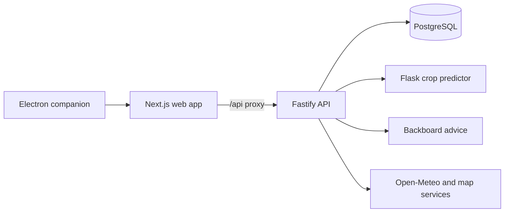

<p align="center">
  
</p>

# Maati

**A gentle nudge to step away from your screen and spend a little time outside.**

Maati is a community break companion for people who spend long hours at a computer. Its web app combines a social feed and personal scrapbook with a floating desktop tree that tracks active screen time and suggests a short break. Depending on the time of day, a mission can be a seed planting activity, a nearby city outing, or an indoor audio reset.

> Maati is an evolving prototype. Review the deployment notes and known limitations before making it available to the public.

## What it does

- Tracks active screen time in the optional Windows desktop companion and prompts the user when a break is due.
- Offers three types of break: a daytime nature or seed activity, an evening outing, and a late-night indoor audio break.
- Includes a TabPFN crop predictor for the sponsor build and a smaller scikit-learn predictor for a temporary free-tier demo, both using the Crop Recommendation dataset.
- Uses Backboard for structured mission advice and map services for nearby place and transit information.
- Lets signed-in users save their preferences, accept a mission, record its completion, and share a scrapbook post with the community.
- Stores accounts, profile data, missions, posts, and related records in PostgreSQL.

## Project layout

```text
backend/
  ai/                 Flask predictors and AI data scripts
  data/               Crop Recommendation dataset
  db/                 PostgreSQL schema
  server.js           Fastify API
frontend/
  src/app/             Next.js App Router pages
  src/components/      Feed, scrapbook, mission, and companion UI
  main.js              Electron desktop companion
render.yaml            Render Blueprint for the web, API, and predictor
DEPLOYMENT.md           Render and desktop release notes
```

## Architecture



The Next.js server proxies `/api/*` to Fastify. The API handles authentication, profiles, break state, missions, posts, and external service calls. The predictor is a separate Python web service; its prediction route requires a shared service token. PostgreSQL schema initialization runs when the API starts.

## Run locally

### Prerequisites

- Node.js 22 LTS or newer
- Python and pip, with a Python version supported by the installed TabPFN release
- PostgreSQL, locally or hosted
- A Backboard API key for mission advice
- A TabPFN token if the model requires license acceptance to download its inference weights
- A Google Maps API key for transit route details; without it, the app can still provide a directions link

### 1. Configure the backend

Create `backend/.env` from the placeholder template and fill in the values for your own services:

```powershell
Copy-Item backend/.env.example backend/.env
```

Set `DATABASE_URL`, `BACKBOARD_API_KEY`, and `GOOGLE_MAPS_API_KEY` in `backend/.env`. Set `TABPFN_TOKEN` there too when required by TabPFN. Keep this file private; it is ignored by Git.

Install backend dependencies and start the API:

```powershell
cd backend
npm ci
npm start
```

The API listens on port `3000` by default. It creates or updates the PostgreSQL schema during startup. Check `http://localhost:3000/api/healthz` after startup.

### 2. Start the predictor

In a second terminal, create a virtual environment and install the lightweight predictor dependencies for a free-demo-style local run:

```powershell
cd backend
python -m venv .venv
.\.venv\Scripts\Activate.ps1
pip install -r ai/requirements-lite.txt
python ai/sklearn_predictor.py
```

The lightweight predictor reads the full real dataset and trains once at startup. It listens on port `5000` by default. The API uses `http://127.0.0.1:5000/predict` by default; set `PREDICTOR_URL` or `PREDICTOR_BASE_URL` if it runs at another address. This model only uses temperature and humidity, so its score is an experimental crop-recommendation signal, not a calibrated germination probability.

To run the TabPFN sponsor version instead, install `ai/requirements.txt`, configure `TABPFN_TOKEN` in `backend/.env` if requested, and run `python ai/tabpfn_predictor.py`. Its first model download takes longer and needs more memory.

### 3. Start the web app

In a third terminal:

```powershell
cd frontend
npm ci
npm run dev
```

Open [http://localhost:3001](http://localhost:3001). Next.js forwards `/api/*` requests to `http://127.0.0.1:3000` by default. To use another API origin, set `MAATI_BACKEND_URL` before starting the Next.js server.

### 4. Optional: run the desktop companion

Keep the web app running, then in another terminal:

```powershell
cd frontend
npm run electron
```

To create a Windows installer:

```powershell
npm run desktop:win
```

The installer is generated under `frontend/release/` and is intentionally excluded from Git. See [DEPLOYMENT.md](DEPLOYMENT.md) for production URL and release notes.

## API overview

The main API routes are served by Fastify and are accessed through the Next.js `/api` proxy:

| Area | Routes |
| --- | --- |
| Health | `GET /api/healthz` |
| Authentication | `POST /api/auth/signup`, `POST /api/auth/login`, `POST /api/auth/logout`, `GET /api/auth/me` |
| Profile and break state | `GET /api/me`, `PUT /api/profile`, `GET/PUT /api/break-state`, `PUT /api/screen-time` |
| Missions | `POST /api/viability`, `POST /api/advice`, `POST /api/places/recommend`, `POST /api/accept-mission`, `POST /api/missions/complete` |
| Community | `GET /api/feed`, `POST /api/posts/:postId/reactions`, `PUT /api/posts/:postId` |

Most account and mission routes require a signed-in session.

## Deploy to Render

The repository includes a **temporary free-demo Blueprint** in [`render.yaml`](render.yaml) for three free web services: the Fastify API, a lightweight Flask/scikit-learn predictor, and the Next.js web app. The TabPFN predictor remains available in `backend/ai/tabpfn_predictor.py` for the sponsor build; the free Render configuration does not run it.

1. Push this repository to GitHub and create a new Render Blueprint from it.
2. Configure the required secrets in Render: `DATABASE_URL`, `BACKBOARD_API_KEY`, and `GOOGLE_MAPS_API_KEY`. Render generates the predictor-to-API authentication token.
3. Render generates `AUTH_SECRET` from the Blueprint. Keep all API keys and database credentials in Render's environment settings, never in frontend variables.
4. Wait for all services to deploy, then check the API health endpoint and exercise signup, profile setup, mission generation, completion, and posting.
5. The Blueprint connects services using their public HTTPS URLs because free web services can't receive private-network traffic. If Render assigns a web URL other than the default in `frontend/main.js`, set `MAATI_WEB_URL` for a local packaged build or update `PRODUCTION_WEB_URL` before building the desktop installer.

Free services sleep after 15 minutes without inbound requests, have limited CPU and memory, and can cold-start slowly. A three-service demo uses 216 instance-hours if all three run continuously for 72 hours, within Render's current 750-hour monthly workspace allowance; usage is shared across the workspace. External monitoring requests may keep them active, but Render can still restart free services. Review [DEPLOYMENT.md](DEPLOYMENT.md) before launch. For the TabPFN sponsor build or a durable production deployment, restore a paid private predictor configuration and confirm current pricing first.

## Security and prototype notes

- Never commit `.env` files, access tokens, database URLs, or private keys. Use `.env.example` only for placeholder values.
- The current signup flow allows passwords as short as six characters to support prototype testing. Strengthen this policy before opening registration to the public.
- Protect the PostgreSQL database with a fresh credential and restrict access through the hosting provider.
- The desktop companion is an optional Windows app; the web app and account flows do not install it automatically.
- External advice, place discovery, and transit details depend on third-party service availability and configured credentials.
